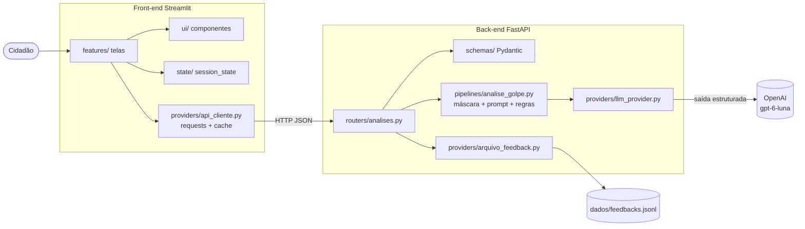

# 🛡️ Alerta Golpe

Global Solution 2026/2 - Front-end em Sistemas de IA (desafio CitizenTech)

**Integrantes:**
- Arthur Pedreca de Almeida Vasco - RM565215
- Bruno Lanchariche Fitipaldi Lopes - RM564129

**Vídeo:** _(colar aqui o link do YouTube não listado)_

O Alerta Golpe é uma aplicação web onde o cidadão cola uma mensagem suspeita (WhatsApp, SMS, e-mail, ligação...) e recebe na hora o nível de risco de golpe, o que chamou atenção na mensagem, o que fazer agora e onde pedir ajuda.

---

## 1. Problema e público

Golpe por celular virou o crime contra o patrimônio mais comum do Brasil. Em 2025 foram registrados **2.261.055 casos de estelionato**, uma média de **258 por hora**, e o número cresceu **429,8% desde 2018** (20º Anuário Brasileiro de Segurança Pública, FBSP). Mesmo com tantos registros, só 63.771 processos penais foram abertos e 4.819 pessoas foram presas por esse crime em 2025, ou seja, depois que o dinheiro sai, é muito difícil recuperar. Por isso a ideia é agir **antes** do Pix.

Uma pesquisa do DataSenado (2024, com 21.808 entrevistados) mostrou que **24% dos brasileiros com mais de 16 anos perderam dinheiro com golpe digital** em 12 meses. Não existe um perfil único de vítima: 27% têm entre 16 e 29 anos, e **51% das vítimas têm renda familiar de até 2 salários mínimos**.

**Público:** qualquer pessoa que recebe mensagens no celular e não tem certeza se é golpe, com foco em quem tem pouca familiaridade com tecnologia (pais, avós, quem usa o celular só para WhatsApp e banco) e em famílias de baixa renda, para quem perder algumas centenas de reais faz muita falta.

**Dor concreta:** a pessoa recebe "Oi mãe, troquei de número, me faz um Pix?" ou "sua encomenda está retida, pague a taxa", fica na dúvida e não tem para quem perguntar rápido. O golpe funciona justamente pela pressa.

Fontes no final do README.

## 2. Fluxo CitizenTech

| Etapa | O que acontece | Onde está no código |
|---|---|---|
| **Entrada** | O cidadão cola a mensagem, escolhe por onde ela chegou e diz se ela pede dinheiro. O front valida antes de enviar (campo vazio, mínimo 10 e máximo 2000 caracteres, canal obrigatório). | `frontend/features/verificar.py` |
| **Processamento** | O front chama a nossa API (`POST /v1/analises`). A API valida de novo com Pydantic, esconde CPF, telefone, e-mail e cartão, e chama a OpenAI pedindo uma resposta no formato do modelo `AnaliseIA` (saída estruturada). | `backend/routers/analises.py`, `backend/pipelines/analise_golpe.py`, `backend/providers/llm_provider.py` |
| **Resposta** | Cartão colorido com o nível de risco (com ícone e texto), tipo de golpe, sinais de alerta, o que fazer e onde pedir ajuda, com número de protocolo. | `frontend/features/verificar.py`, `frontend/ui/componentes.py` |
| **Human-in-the-loop** | O cidadão diz se a análise está certa ou errada e, se estiver errada, escolhe o nível correto. O nível corrigido é o que vale no histórico e no gráfico, e a avaliação vai para a API. | `verificar.py` (função `avaliacao`), `POST /v1/feedback` |
| **Histórico** | Todas as análises da sessão ficam no estado e alimentam o gráfico Plotly e os filtros. | `frontend/state/sessao.py`, `frontend/features/historico.py` |

## 3. Arquitetura



```
alerta-golpe/
├── backend/
│   ├── main.py                    cria a API, CORS e /health
│   ├── config.py                  lê o .env
│   ├── routers/analises.py        rotas /v1/analises, /v1/feedback, /v1/tipos-golpe
│   ├── schemas/analise.py         modelos Pydantic de entrada e saída
│   ├── pipelines/analise_golpe.py máscara de dados pessoais, prompt e regras
│   ├── providers/llm_provider.py  única parte que fala com a OpenAI
│   ├── providers/arquivo_feedback.py  salva as avaliações (sem o texto da mensagem)
│   ├── requirements.txt
│   └── Dockerfile
├── frontend/
│   ├── app.py                     página principal (abas e barra lateral)
│   ├── features/                  verificar.py, historico.py, dicas.py (uma tela cada)
│   ├── ui/componentes.py          cartão de risco, listas, estado vazio, caixa de erro
│   ├── state/sessao.py            histórico e última análise no st.session_state
│   ├── providers/api_cliente.py   cliente HTTP da API, tratamento de erro e cache
│   ├── requirements.txt
│   └── Dockerfile
├── testes_ia/rodar_casos.py       roda os casos de teste da IA e gera a tabela
├── docs/                          roteiro do teste com pessoas e roteiro do vídeo
├── docker-compose.yml
└── .env.example
```

Usamos a estrutura vista em aula. O front nunca fala com a OpenAI, só com a API. A chave fica só no back-end.

## 4. Como rodar

### Com Docker (opção de deploy escolhida)

Precisa do Docker Desktop instalado.

```bash
cp .env.example .env          # no Windows: copy .env.example .env
# abra o .env e coloque sua OPENAI_API_KEY
docker compose up --build
```

- Aplicação: http://localhost:8501
- Documentação da API (Swagger): http://localhost:8000/docs

Para ver o tratamento de erro com a API fora do ar: `docker compose stop api` e tente verificar uma mensagem. Para voltar: `docker compose start api`.

### Sem Docker

Precisa de Python 3.10 ou mais novo. Crie o `.env` igual acima (na raiz do projeto).

```bash
# terminal 1 - back-end
cd backend
pip install -r requirements.txt
uvicorn main:app --reload

# terminal 2 - front-end
cd frontend
pip install -r requirements.txt
streamlit run app.py
```

### Variáveis do .env

| Variável | Para que serve |
|---|---|
| `OPENAI_API_KEY` | chave da OpenAI (só o back-end usa) |
| `OPENAI_MODEL` | modelo usado, padrão `gpt-6-luna` |
| `OPENAI_REASONING_EFFORT` | esforço de raciocínio do modelo, padrão `low` |
| `OPENAI_TIMEOUT` | tempo máximo esperando a OpenAI, em segundos |
| `CORS_ORIGINS` | sites que podem chamar a API pelo navegador (sem `*`) |
| `API_URL` | endereço da API usado pelo front (no Docker já é configurado no compose) |

## 5. Requisitos da disciplina

| Requisito | Como fizemos |
|---|---|
| Validação de entrada | No front (`validar()` em `verificar.py`, `max_chars`) e no back (`PedidoAnalise` com `min_length`, `max_length` e `Literal` para o canal). Erro de validação volta 422. |
| LLM só no back-end, com saída estruturada | `llm_provider.py` usa `client.chat.completions.parse(..., response_format=AnaliseIA)`. O nível e o tipo de golpe são `Literal`, então a IA só pode responder valores da lista. |
| Resposta útil e não dump de texto | Cartão de risco, listas separadas e protocolo. Os canais de ajuda vêm de uma lista fixa no código, não da IA. |
| Estado | `st.session_state` guarda o histórico, a última análise e a avaliação (`state/sessao.py`). O resultado é mostrado a partir do estado, então clicar nos botões da avaliação não chama a IA de novo. |
| Cache | `@st.cache_data` na análise (mesma mensagem não chama a IA de novo por 30 min), na lista de tipos de golpe (1 h) e no status da API (10 s). `@st.cache_resource` na sessão HTTP do `requests`. O formulário usa `st.form` para não rodar a cada letra digitada. |
| Tratamento de falhas | API fora do ar, timeout, erro da IA (503), resposta fora do formato (502) e resposta incompleta são tratados em `api_cliente.py` com mensagens simples para o cidadão. Nenhum erro técnico aparece na tela. |
| Segredos | Chave no `.env`, que está no `.gitignore`. O repositório tem o `.env.example`. |
| CORS | `CORSMiddleware` com as origens do `.env` (padrão só `http://localhost:8501`), só GET e POST. |
| Dados pessoais | CPF, telefone, e-mail e cartão são trocados por marcas antes de ir para a OpenAI. O texto da mensagem não é gravado. O feedback guarda só protocolo, nível e comentário (também mascarado). |
| Layout | 3 abas (Verificar, Histórico, Como se proteger), colunas e barra lateral com status do serviço, passo a passo e aviso de privacidade. |
| Latência | `st.spinner` durante a análise, estado vazio quando não tem resultado ou histórico, caixa de erro com dica de segurança. |
| Human-in-the-loop | O cidadão marca "Está certa" ou "Está errada" e corrige o nível. O nível corrigido passa a valer no histórico e no gráfico. |
| Plotly + filtros | Gráfico de barras interativo (hover e zoom) por tipo de golpe ou por canal, com filtro de nível de risco, filtro de canal e escolha do agrupamento. |
| Componente reutilizável | `cartao_risco()` é usado no resultado (grande) e na lista do histórico (`compacto=True`). `lista_com_icone()` é usado 4 vezes com títulos e ícones diferentes. `estado_vazio()` e `caixa_erro()` também aparecem em mais de uma tela. |
| Deploy | Opção B: `Dockerfile` no back e no front e `docker-compose.yml` subindo os dois com `docker compose up`. |

## 6. Cuidados de acessibilidade

- O nível de risco nunca depende só da cor: sempre tem ícone (🚨 ⚠️ ✅) e texto ("Risco alto", "Risco médio", "Risco baixo").
- Contraste das cores do cartão medido pela fórmula do WCAG: vermelho 5,7:1, laranja 6,3:1 e verde 7,2:1 sobre o fundo claro (o mínimo AA é 4,5:1).
- Todos os campos têm rótulo visível e alguns têm texto de ajuda (ícone "?").
- O cartão de resultado tem `role="status"` e `aria-live="polite"`, para leitor de tela anunciar o resultado.
- O gráfico tem texto alternativo (`alt`) e as mesmas informações aparecem em texto na lista abaixo dele.
- Linguagem simples, sem termos técnicos (o prompt proíbe palavras como "phishing").
- Mensagens de erro dizem o que fazer ("Cole a mensagem que você recebeu", "Tente de novo em alguns minutos").
- Os componentes do Streamlit funcionam com teclado (Tab e Enter).

## 7. Justificativa, validação e impacto social

### 7.1 ODS

- **ODS 16 - Paz, Justiça e Instituições Eficazes.** Golpe é crime e quase nunca é punido (2,26 milhões de registros e menos de 64 mil processos em 2025). Ajudar o cidadão a identificar o golpe antes de pagar e orientar a fazer o B.O. e avisar o banco contribui para reduzir esse crime.
- **ODS 10 - Redução das Desigualdades.** Metade das vítimas tem renda familiar de até 2 salários mínimos. A ferramenta é gratuita, usa linguagem simples e não exige conhecimento de tecnologia, então ajuda justamente quem tem menos acesso a informação de segurança digital.

### 7.2 Decisões técnicas

- **Por que Streamlit:** foi usado nos checkpoints da disciplina e já tem abas, colunas, barra lateral, `session_state`, cache e integração com Plotly. O Gradio é mais voltado para demonstrar entrada e saída de um modelo, e aqui a gente precisava de várias telas (verificar, histórico com gráfico e dicas).
- **Por que esse prompt:** o prompt de sistema define critérios claros para cada nível, manda escolher o nível mais alto em caso de dúvida (deixar passar um golpe é pior que um alarme falso), proíbe escrever telefones e links (para a IA não inventar contato falso) e coloca a mensagem entre `<mensagem>` e `</mensagem>` dizendo para não obedecer ordens que estejam dentro dela.
- **Por que saída estruturada:** com texto livre não daria para colorir o resultado, contar no gráfico nem filtrar. Com o modelo `AnaliseIA` (Pydantic) e `Literal`, a IA só pode responder um dos 3 níveis e um dos 10 tipos de golpe da lista.
- **Regra de segurança no pipeline:** se o cidadão disse que a mensagem pede dinheiro, Pix, senha ou código, o resultado nunca sai como risco baixo (sobe para médio e a tela explica o motivo).
- **Por que o gpt-6-luna:** é o modelo usado nos checkpoints anteriores, é barato e rápido e aceita saída estruturada no Chat Completions. Dá para trocar no `.env`.
- **Por que Docker:** sobe front e back com um comando, funciona igual em qualquer máquina e a chave fica só no `.env` de quem roda.

### 7.3 Ética e limites da IA

**Riscos**
- **Erro:** a IA pode dizer que uma mensagem é segura quando é golpe (o pior caso) ou o contrário.
- **Viés:** mensagens com erros de português ou gírias podem ser vistas como mais suspeitas, o que pode prejudicar mensagens reais de pessoas com menos escolaridade.
- **Alucinação:** a IA poderia inventar um telefone ou site "oficial". Por isso ela é proibida de escrever contatos, links da resposta são removidos no pipeline e os canais de ajuda vêm de uma lista fixa no código.
- **Uso indevido:** um golpista poderia usar a ferramenta para testar mensagens até achar uma que passe como "risco baixo". Também alguém pode colar uma mensagem com ordens para a IA (prompt injection), o que é tratado no prompt.
- **Privacidade:** a mensagem pode ter dados pessoais. Eles são mascarados antes de ir para a OpenAI e o texto não é gravado.

**O que a solução NÃO faz**
- Não abre links nem confere se um site, número ou chave Pix é de golpista.
- Não bloqueia números, não faz denúncia e não recupera dinheiro.
- Não substitui o banco, a polícia ou o Procon, e não dá garantia de que a mensagem é segura.

**Como o human-in-the-loop ajuda:** o cidadão pode marcar a análise como errada e corrigir o nível, e o histórico passa a usar a correção. As avaliações ficam salvas na API (sem o texto da mensagem) para a gente revisar onde a IA mais erra e ajustar o prompt.

### 7.4 Evidências de validação

#### (a) Teste com pessoas do público-alvo

Roteiro completo em [`docs/validacao_usuarios.md`](docs/validacao_usuarios.md).

| Pessoa | Perfil | O que observamos | Nota de facilidade (1 a 5) |
|---|---|---|---|
| Pessoa 1 | _(preencher)_ | _(preencher)_ | _(preencher)_ |
| Pessoa 2 | _(preencher)_ | _(preencher)_ | _(preencher)_ |
| Pessoa 3 | _(preencher)_ | _(preencher)_ | _(preencher)_ |

**Ajuste feito a partir do feedback:** _(preencher: o que as pessoas falaram, o que mudamos e em qual arquivo)_

#### (b) Casos de teste da IA

As mensagens abaixo foram escritas por nós imitando golpes comuns citados nas fontes (não são mensagens reais de ninguém). A coluna "Saída obtida" é gerada rodando `python testes_ia/rodar_casos.py` com a API ligada.

| # | Entrada | Saída esperada (nível / tipo) | Saída obtida | Ajuste realizado |
|---|---|---|---|---|
| 1 | WhatsApp: "Oi mãe, troquei de número... Consegue me fazer um Pix de R$ 850?" | alto / Falso parente ou amigo | _(rodar script)_ | _(preencher)_ |
| 2 | SMS: "CORREIOS: Sua encomenda está retida por falta de pagamento da taxa de R$ 12,90..." com link | alto / Falsa entrega ou taxa | _(rodar script)_ | _(preencher)_ |
| 3 | Ligação: "Aqui é da central de segurança do seu banco... informe o código que vai chegar por SMS" | alto / Falsa central do banco | _(rodar script)_ | _(preencher)_ |
| 4 | WhatsApp: "Oi pessoal, a reunião do condomínio foi remarcada para quinta às 19h..." | baixo / Não parece golpe | _(rodar script)_ | _(preencher)_ |
| 5 | Rede social: "Vaga home office! Ganhe R$ 300 por dia só curtindo vídeos... taxa de cadastro de R$ 49" | alto / Falsa vaga de emprego | _(rodar script)_ | _(preencher)_ |

## 8. Fontes

- Olhar Digital, 23/07/2026 - "O golpe que mais cresce no Brasil está no seu celular" (dados do 20º Anuário Brasileiro de Segurança Pública, FBSP): https://olhardigital.com.br/2026/07/23/seguranca/o-golpe-que-mais-cresce-no-brasil-esta-no-seu-celular-entenda/
- BNews São Paulo - "Estelionato bate recorde e Brasil registra 258 golpes por hora, aponta Anuário" (processos e prisões): https://www.bnewssaopaulo.com.br/noticias/policia/estelionato-bate-recorde-e-brasil-registra-258-golpes-por-hora-aponta-anuario.html
- Agência Senado, abril/2025 - "Golpes virtuais aumentam e não fazem distinção de idade" (pesquisa DataSenado): https://www12.senado.leg.br/noticias/infomaterias/2025/04/golpes-virtuais-aumentam-e-nao-fazem-distincao-de-idade
- Olhar Digital, 30/09/2024 - "Um a cada quatro brasileiros perdeu dinheiro em golpes digitais no último ano" (pesquisa DataSenado/Nexus): https://olhardigital.com.br/2024/09/30/seguranca/um-a-cada-quatro-brasileiros-perdeu-dinheiro-em-golpes-digitais-no-ultimo-ano-veja-os-mais-comuns/
- OpenAI - página do modelo gpt-6-luna (saída estruturada no Chat Completions): https://developers.openai.com/api/docs/models/gpt-6-luna
